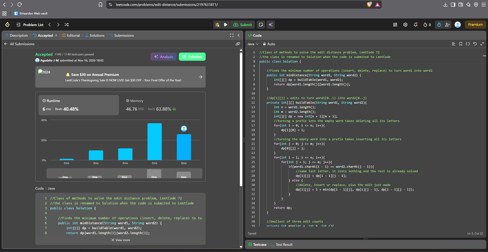
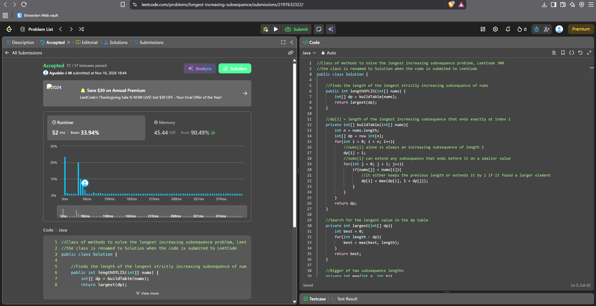
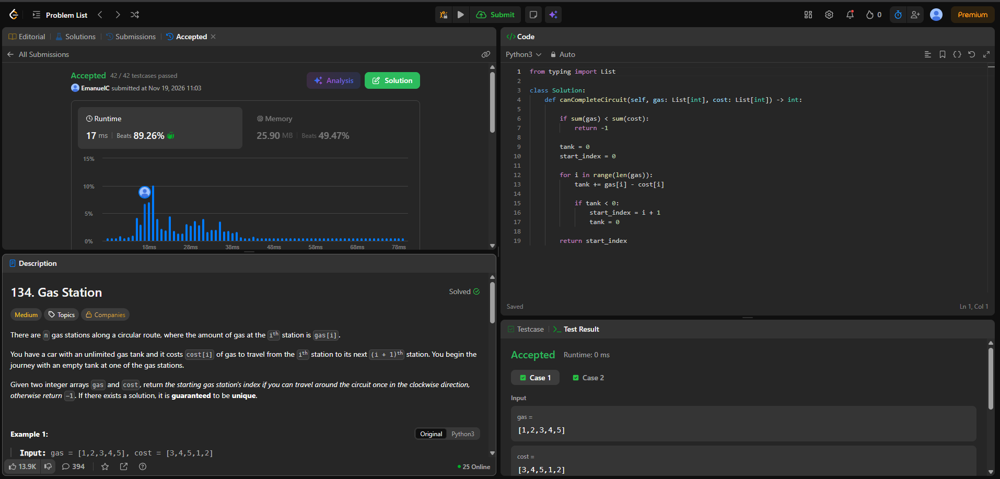
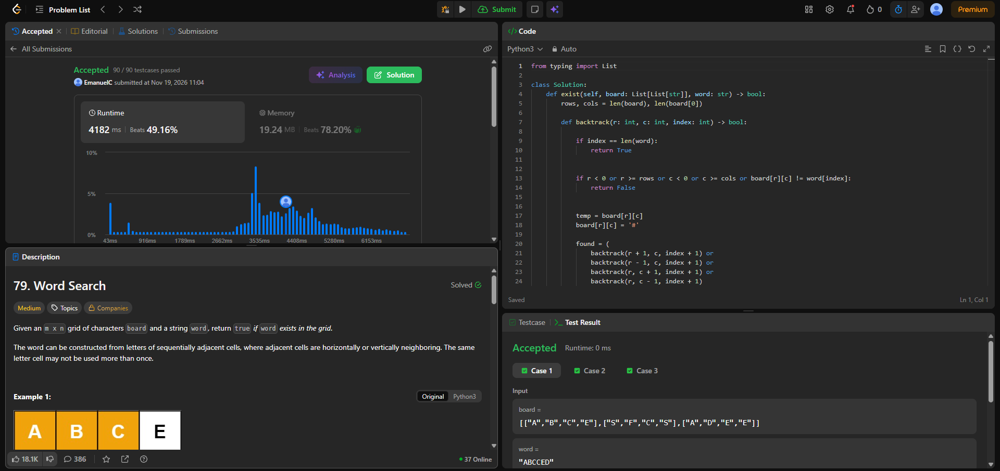

# Taller Final - Análisis de Algoritmos

## Integrantes

| Integrante            | Usuario de GitHub | Ejercicios |
| --------------------- | ----------------- | ---------- |
| Ivan Morales Salgado  | ivnmorales        | 215, 179   |
| Carlos Andres Arteaga | caarteagag        | 743, 1584  |
| Mauricio Agudelo      | Agudelo-J-M       | 72, 300    |
| Emanuel Cardona       | Rhast-dev         | 134, 79    |

## 215. Kth Largest Element in an Array

Problema: https://leetcode.com/problems/kth-largest-element-in-an-array/

Autor: Ivan Morales Salgado(ivnmorales)

Familia: Heap

Idea: Utilice un min-heap que guarda los k números más grandes del arreglo. Voy recorriendo los números y si encuentro uno mayor que el más pequeño del heap lo reemplazo. Al final el primer elemento del heap es el k-ésimo número más grande.

Complejidad:

Tiempo: O(n log k), porque se recorren los n elementos y las operaciones del heap pueden tomar O(log k).

Espacio: O(k), porque el heap guarda como máximo k elementos.


## 179. Largest Number

Problema: https://leetcode.com/problems/largest-number/

Autor: Ivan Morales Salgado(ivnmorales)

Familia: Ordenamiento

Idea: Utilice Merge Sort para ordenar los números pero primero los convertí en cadenas de texto. Para saber cuál debe ir primero comparo las dos formas de unirlos. Por ejemplo, entre 10 y 2, comparo 102 y 210, y dejo primero el 2 porque así se forma un número mayor. Al final uno todos los números en una sola cadena.

Complejidad:

Tiempo: O(n log n) comparaciones, porque se utiliza Merge Sort. Cada comparación también depende de la cantidad de dígitos de los números.

Espacio: O(n), porque se crean arreglos auxiliares durante el ordenamiento, considerando que cada número tiene una cantidad limitada de dígitos.


## 743. Network Delay Time

Problema: https://leetcode.com/problems/network-delay-time/

Autor: Carlos Andres Arteaga (`caarteagag`)

Familia: Grafos (Dijkstra)

Idea: Modelé la red como un grafo dirigido y ponderado (cada arco u → v tiene peso w). Desde el nodo k corro Dijkstra con un min-heap de distancias tentativas: siempre saco el nodo con menor tiempo acumulado, lo cierro y relajo sus arcos. Si algún nodo nunca se cierra, la señal no llega a todos y devuelvo -1; si todos se cierran, la respuesta es la mayor distancia final, porque hay que esperar al nodo que más tarda.

Complejidad:

Tiempo: O((n + m) log n), con n nodos y m = `times.length` arcos. Cada arco puede generar una entrada en el heap, y cada operación del heap cuesta O(log m), que es O(log n) porque m ≤ n².

Espacio: O(n + m), por el grafo de adyacencia, el heap y el diccionario de distancias.


## 1584. Min Cost to Connect All Points

Problema: https://leetcode.com/problems/min-cost-to-connect-all-points/

Autor: Carlos Andres Arteaga (`caarteagag`)

Familia: Grafos (árbol de recubrimiento mínimo)

Idea: Usé Prim sobre el grafo completo, donde el costo de unir dos puntos es la distancia de Manhattan. Empiezo el árbol en el punto 0 y guardo para cada punto fuera del árbol el costo mínimo de conectarlo. En cada paso elijo el punto fuera del árbol con menor costo, lo agrego (sumando ese costo) y actualizo los costos de los demás puntos con la distancia al nuevo punto. Al final la suma es el costo mínimo para conectar todos.

Complejidad:

Tiempo: O(n²), con n = `points.length`. Como el grafo es completo (Θ(n²) aristas), en cada uno de los n pasos se recorren los n puntos para buscar el mínimo y actualizar costos.

Espacio: O(n), por los arreglos de costos y de puntos dentro del árbol.


## 72. Edit Distance

Problema: https://leetcode.com/problems/edit-distance/

Código: [`edit-distance/src/EditDistance.java`](edit-distance/src/EditDistance.java)

Autor: Mauricio Agudelo (`Agudelo-J-M`)

Familia: Programación dinámica (tabla de Wagner–Fischer)

Idea: En vez de comparar las dos palabras completas, resuelvo el problema para todos los pares de prefijos, del más corto al más largo, y guardo cada respuesta en una tabla. Para cada par solo miro la última letra de cada prefijo: si son iguales no cuesta nada y queda el mismo problema sin esas dos letras; si son distintas, algo hay que hacerle a esa letra (borrarla, insertar la que falta o sustituirla), eso cuesta 1 y queda un problema más pequeño que ya está resuelto en la tabla. Se pide el número de ediciones, no la lista de operaciones.

Estado: `dp[i][j]` = mínimo de ediciones para convertir `word1[0..i)` (las primeras `i` letras) en `word2[0..j)` (las primeras `j` letras). La tabla es de `(n + 1) × (m + 1)` porque la fila 0 y la columna 0 representan la palabra vacía; así el índice coincide con la cantidad de letras usadas y la respuesta queda en `dp[n][m]`, la esquina inferior derecha.

Base: `dp[i][0] = i` (convertir `i` letras en la palabra vacía es borrarlas todas) y `dp[0][j] = j` (convertir la palabra vacía en `j` letras es insertarlas todas).

Recurrencia:

- si `word1[i−1] == word2[j−1]` (las últimas letras coinciden), `dp[i][j] = dp[i−1][j−1]`: se copia la diagonal;
- si no, `dp[i][j] = 1 + min(dp[i−1][j], dp[i][j−1], dp[i−1][j−1])`, donde cada vecina es una operación:
  - arriba, `dp[i−1][j]`: **borrar** la última letra de `word1`;
  - izquierda, `dp[i][j−1]`: **insertar** la última letra de `word2`;
  - diagonal, `dp[i−1][j−1]`: **sustituir** una letra por la otra.

Se usa `charAt(i − 1)` porque la fila `i` significa "las primeras `i` letras" y la última de ellas está en la posición `i − 1` del `String`. La tabla se llena fila por fila y de izquierda a derecha, así que cuando se calcula `dp[i][j]` las tres vecinas (arriba, izquierda y diagonal) ya están llenas.

Ejemplo (`ITM` → `ITEM`, el del pizarrón):

```text
          ""   I   T   E   M
    ""  [  0   1   2   3   4 ]
    I   [  1   0   1   2   3 ]
    T   [  2   1   0   1   2 ]
    M   [  3   2   1   1   1 ]   ← dp[3][4] = 1
```

Leyendo desde la esquina: `M = M`, se copia la diagonal `dp[2][3] = 1` ("IT" → "ITE"); ahí `T ≠ E` y lo más barato es la vecina izquierda `dp[2][2] = 0`, o sea **insertar E**. La respuesta es 1 edición.

Diferencia con LCS: LCS maximiza lo que se conserva; aquí se minimiza el número de ediciones. Un greedy que cambie la primera letra que no coincide no sirve porque no mira el resto de la cadena.

Complejidad:

Tiempo: Θ(n · m), con n = `word1.length` y m = `word2.length`, porque se llenan (n + 1)(m + 1) celdas y cada una cuesta O(1) (una comparación y un mínimo de tres valores).

Espacio: Θ(n · m), por la tabla `dp`.



## 300. Longest Increasing Subsequence

Problema: https://leetcode.com/problems/longest-increasing-subsequence/

Código: [`longest-increasing-subsequence/src/LongestIncreasingSubsequence.java`](longest-increasing-subsequence/src/LongestIncreasingSubsequence.java)

Autor: Mauricio Agudelo (`Agudelo-J-M`)

Familia: Programación dinámica

Idea: Para cada posición `i` calculo la subsecuencia creciente más larga que **termina** exactamente en `nums[i]`. Para eso miro todos los valores anteriores que sean menores: `nums[i]` se puede pegar al final de cualquiera de esas subsecuencias y me quedo con la más larga. No se ordena el arreglo, porque ordenar cambia qué índices se pueden usar.

Estado: `dp[i]` = longitud de la LIS que termina en el índice `i`.

Base: `dp[i] = 1` (el elemento solo ya es una subsecuencia creciente).

Recurrencia: `dp[i] = max(dp[i], 1 + dp[j])` para todo `j < i` con `nums[j] < nums[i]` (estrictamente menor, porque la subsecuencia debe ser estrictamente creciente).

La respuesta es el **máximo** de la tabla y no `dp[n−1]`, porque la LIS más larga puede no terminar en el último elemento; de eso se encarga el método `largest`.

Ejemplo (`[10, 9, 2, 5, 3, 7, 101, 18]`):

| i | nums[i] | menores anteriores que puede extender | dp[i] |
| - | ------- | ------------------------------------- | ----- |
| 0 | 10      | ninguno                               | 1     |
| 1 | 9       | ninguno                               | 1     |
| 2 | 2       | ninguno                               | 1     |
| 3 | 5       | 2 (dp = 1)                            | 2     |
| 4 | 3       | 2 (dp = 1)                            | 2     |
| 5 | 7       | 2, 5, 3 (mejor dp = 2)                | 3     |
| 6 | 101     | todos (mejor: 7, dp = 3)              | 4     |
| 7 | 18      | 10, 9, 2, 5, 3, 7 (mejor: 7, dp = 3)  | 4     |

El máximo de la tabla es 4, por ejemplo `2, 3, 7, 101`.

Complejidad:

Tiempo: Θ(n²), con n = `nums.length`, porque para cada `i` se recorren todos los `j < i` (n(n − 1)/2 comparaciones en total).

Espacio: Θ(n), por el arreglo `dp`.



## 7. [134. Gas Station](https://leetcode.com/problems/gas-station/)

- **Autor:** Emanuel Cardona (`Rhast-dev`)
- **Código:** [gas-station/solution.py](gas-station/solution.py)
- **Familia:** Greedy
- **Idea:** Primero se verifica que la suma total de `gas` sea mayor o igual a la de `cost` (de lo contrario es imposible completar el circuito y se retorna `-1`). En una sola pasada se acumula el balance neto `gas[i] - cost[i]`; cada vez que el tanque cae por debajo de `0` en una estación `i`, se descarta todo el tramo desde el inicio candidato actual hasta `i` (ninguna estación intermedia podría llegar más lejos, pues tenía tanque $\ge 0$ al ser alcanzada) y se fija el nuevo inicio candidato en `i + 1` con el tanque reiniciado en `0`.
- **Complejidad:** Tiempo $\Theta(n)$ en una sola pasada y espacio extra $\Theta(1)$, donde $n$ es el número de estaciones.



---

## 8. [79. Word Search](https://leetcode.com/problems/word-search/)

- **Autor:** Emanuel Cardona (`Rhast-dev`)
- **Código:** [word-search/solution.py](word-search/solution.py)
- **Familia:** Backtracking
- **Idea:** Se recorre la grilla buscando celdas que coincidan con la primera letra de `word`. En cada paso recursivo se elige la celda actual marcándola temporalmente con `#` para evitar reutilizarla en el mismo camino, se exploran sus cuatro vecinos ortogonales buscando la siguiente letra y, si ninguna rama completa la palabra, se deshace la elección restaurando su carácter original antes de retroceder.
- **Complejidad:** Tiempo $O(m \cdot n \cdot 4^L)$ en el peor caso y espacio $O(L)$ por la profundidad de la pila de recursión, donde $m \times n$ son las dimensiones de la grilla y $L$ es la longitud de `word`.


